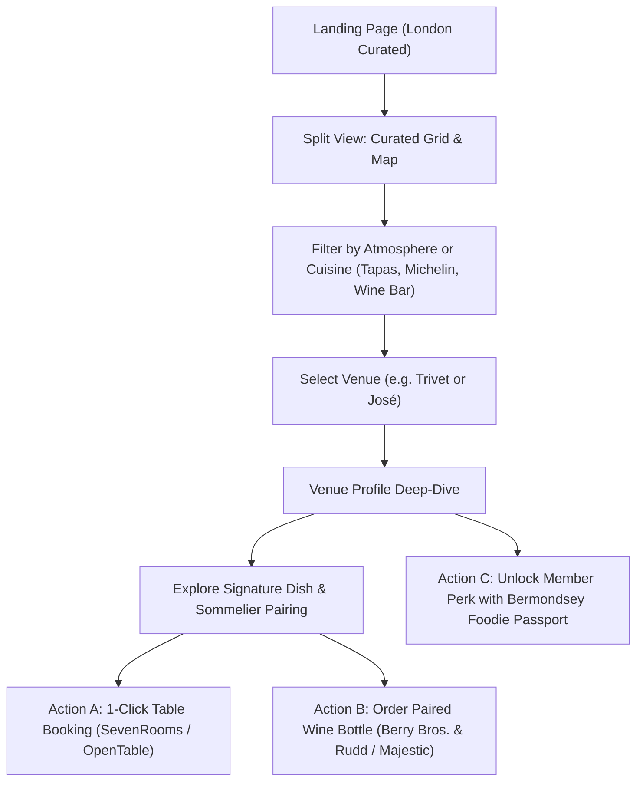

# 🧭 Pillar 3: Application Flow & Mandatory States — London Curated

## 1. End-to-End User Journeys

---

## 2. Step-by-Step Flow Specifications

### Stage 1: Spatial Discovery
1. The user lands on `/` and sees an editorial hero: *"The 21 Curated Dining Rooms of Bermondsey"*.
2. A split interface displays an interactive **MapLibre GL dark vector map** on the left/top and a **curated grid of editorial cards** on the right/bottom.
3. Hovering over a restaurant card smoothly pans the map and highlights its custom Champagne-gold pin.
4. Clicking a pin scrolls the grid directly to the matching restaurant card.

### Stage 2: The Sommelier Pairing Revelation
1. On opening a venue, the user is presented with the **Signature Pairing Showcase**:
   - The Marquee Dish (photo, description, chef notes).
   - The Sommelier Selection (wine style, terroir explanation, biochemical balance).
   - The **"Order the Bottle"** CTA with pricing and direct affiliate link.

### Stage 3: Conversion & Monetization Handshake
1. **Wine Buyer:** Clicks "Order Bottle" → redirected to Berry Bros. & Rudd / Majestic with affiliate tracking attached.
2. **Table Booker:** Clicks "Reserve Table" → redirected directly to the restaurant's SevenRooms/OpenTable booking widget.
3. **Dining Club Member:** Clicks "Claim Member Perk" → opens the `/passport` membership checkout flow.

---

## 3. Mandatory UI States Contract

| Component | Loading State | Empty / Filter Zero State | Error State |
| :--- | :--- | :--- | :--- |
| **Interactive Map** | Subtle dark skeleton with pulsing center coordinates | Displays "No venues found for selected filters" with a "Reset Filters" button | Falls back gracefully to static SVG street layout without crashing UI |
| **Venue Grid** | 6 shimmer card skeletons with pulsating gold accents | Clean editorial empty slate: *"No spots match this exact criteria. Try exploring Basque Tapas or Michelin Stars."* | Shows offline retry banner with cached local collection fallback |
| **Sommelier Drawer** | Shimmer badge with tasting glass icon | Default house pairing recommendation | Fallback to classic European pairing heuristic |
